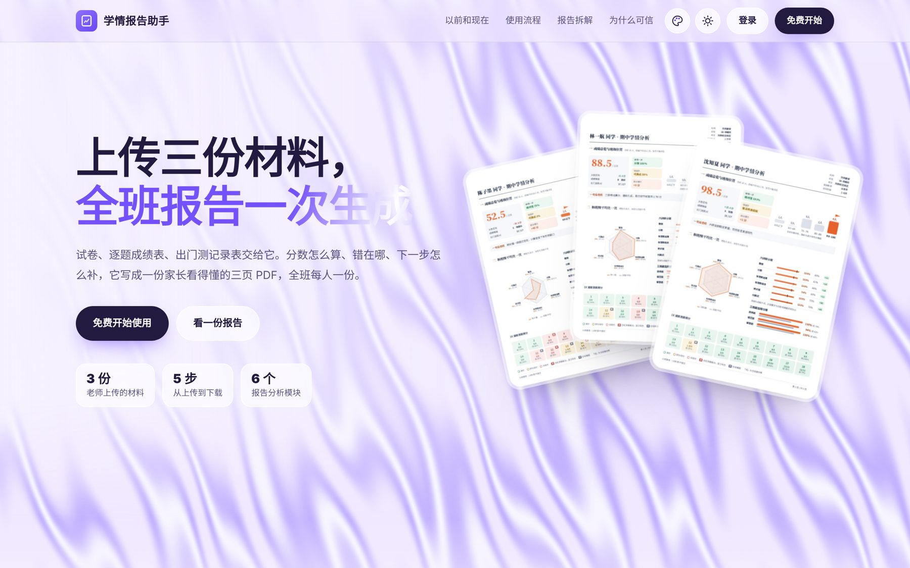
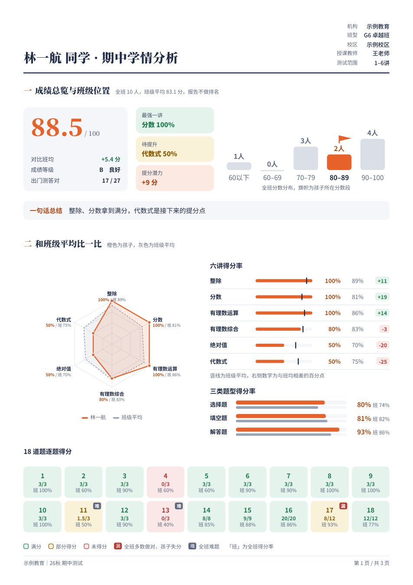
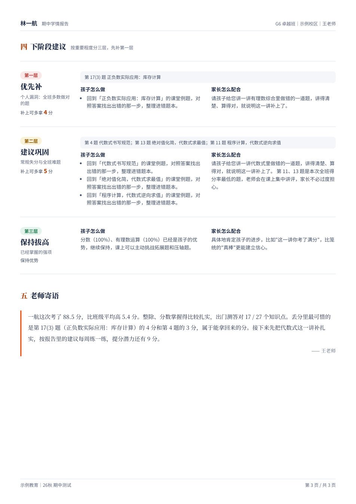
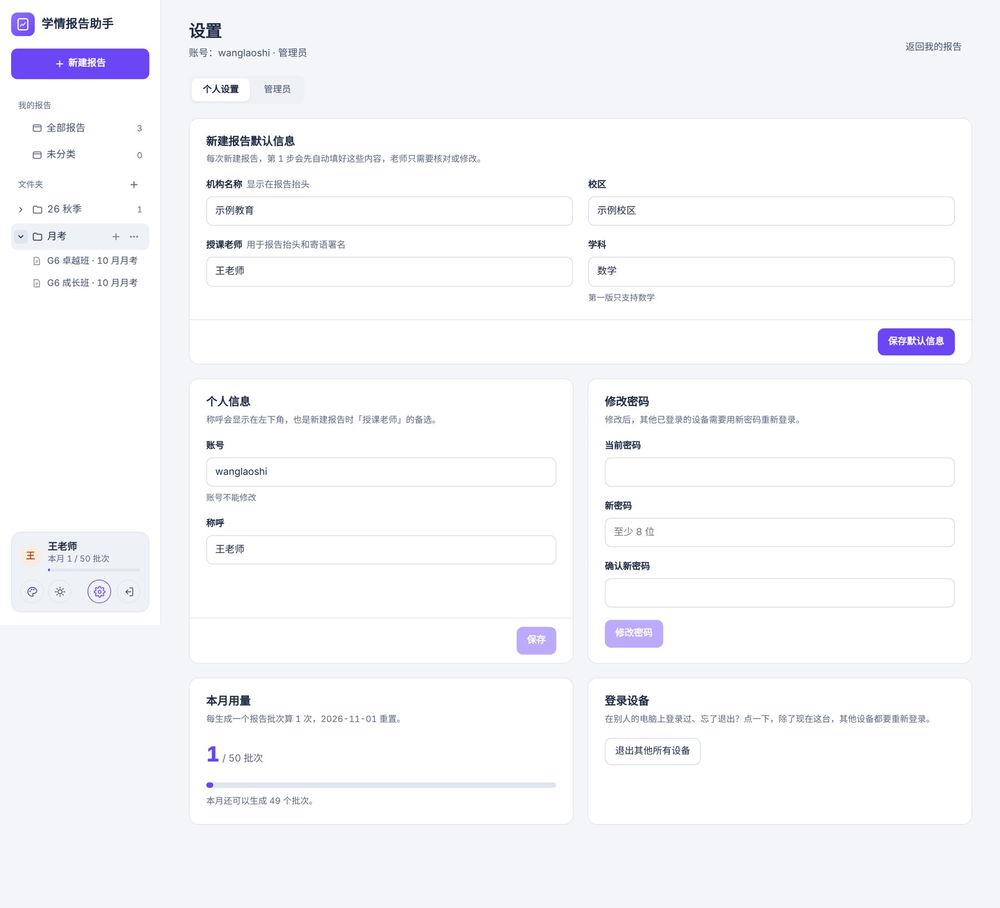

<div align="center">

# 学情报告助手

**上传三份材料，全班每位学生的学情报告一次生成**

给教培机构老师用的 AI 网站：试卷 + 逐题成绩表 + 课堂出门测 → 每位学生一份家长看得懂的 3 页 PDF

[](./backend)
[](./backend/app)
[](./frontend)
[](./docs/DEPLOY.md)
[](./LICENSE)



<sub>截图中的机构、老师、学生和成绩均为虚构示例</sub>

</div>

---

## 它解决什么问题

每次考完试，老师都要给家长一份像样的反馈。以前全靠手工：

| 以前（每个学生都要做一遍） | 现在（整个班级只做一遍） |
|---|---|
| ① 对着成绩表，一题一题算得分率 | ① 上传三份材料 |
| ② 翻出门测记录，逐讲对照谁没听懂 | ② 只核对系统标红的几格 |
| ③ 判断每个孩子丢的分属于哪一类 | ③ 看一眼寄语，下载全班报告 |
| ④ 写建议和寄语 | |
| ⑤ 作图、排版、导出 | |
| ⑥ 发出前再核一遍数字 | |

**业务目标**：用专业、可信、家长看得懂的反馈，提升家长的续费意愿。

## 核心设计

### 数字由程序算，文字由大模型写
班均、得分率、失分类型、提分潜力，全部按公开的规则计算，**同样的成绩永远得到同样的报告**。大模型只做两件事：读懂图片和 PDF 材料，把结论写成家长听得懂的话。→ [规则详情](./docs/ARCHITECTURE.md#3-规则分析backendengineanalyzepy)

### 错误数据进不了报告
识别完成后先进入核对：超出满分、总分对不上、名单重复、讲次缺失，都标红拦下，点一下就能修正；识别没把握的格子标黄提醒。


### 老师只确认，不重复劳动
- 机构、校区、老师名设置一次，以后**每次新建都会自动填好**。
- 班级和考试名称从成绩表的表头**自动识别**。
- 报告逐份预览，只需要看"一句话总结"和"寄语"两段文字；不满意可以一键重写。


## 生成的报告

<p align="center">
  
</p>

| 页 | 内容 |
|---|---|
| 第 1 页 | 成绩总览与班级位置、一句话总结、各讲得分率和班均对比、雷达图、题型得分率、逐题得分 |
| 第 2 页 | 课堂出门测对照考试（稳定掌握 / 已经补上 / 考试失分 / 需要关注）、失分分析与提分潜力 |
| 第 3 页 | 学习建议、续报课程规划（上传了课程大纲才有）、老师寄语 |

## 功能一览

| 模块 | 功能 |
|---|---|
| 报告流程 | 5 步向导：填写信息 → 上传材料 → 核对 → 预览与修改 → 下载（单份 PDF / 全班 zip） |
| 材料识别 | Excel / CSV / Word 表格直接解析；图片和 PDF 交给看图模型；提供 Excel 模板下载 |
| 文件管理 | 参照飞书设计的文件夹树：新建、重命名、拖动排序、把报告拖进文件夹、⋯ 菜单（打开 / 重命名 / 创建副本 / 移动到 / 删除）、当前位置高亮 |
| 账号 | 邀请码注册、图形验证码、登录失败锁定、修改密码、退出其他所有设备、注销账号 |
| 设置 | 称呼、新建报告的默认信息、本月用量 |
| 管理员 | 用户列表、重置密码、停用账号、单独调整额度、在网页上更换邀请码 |
| 界面 | 5 种主题色 × 白天 / 夜间；适配手机 |
| 运维 | 一键安装和升级、小内存自动适配、两层限流、fail2ban、每日自动备份 |
| 演示模式 | 不填大模型 Key 也能把整个流程跑通，用来试跑和演示 |

<p>
 
</p>

## 技术栈

| 层 | 选型 |
|---|---|
| 前端 | React 18 + Vite，手写 CSS 设计变量，不依赖 UI 组件库 |
| 后端 | Python FastAPI + SQLite（WAL 模式），线程池跑任务，报告引擎放在子进程里 |
| PDF | 用 HTML 排版，Playwright Chromium 转成 PDF，pymupdf 生成预览图 |
| 大模型 | 任何兼容 OpenAI 接口的服务（通义千问、DeepSeek 等），换模型只改配置 |
| 部署 | Ubuntu + systemd + Nginx，一键安装脚本使用国内镜像 |

详见 [docs/ARCHITECTURE.md](./docs/ARCHITECTURE.md)，包括架构图、生成流程时序图、校验规则、数据模型和接口一览。

## 快速开始

> 🧑‍🏫 **不懂技术？**看 [新手教程](./docs/QUICKSTART.md)：从买服务器、申请大模型 API Key，到邀请老师注册，一步一步照着做，大约 30 分钟。

**部署到服务器**（2 核 2G 就够用）：从 [Releases](../../releases) 下载 `xueqing-release.zip`，上传到服务器后运行：

```bash
apt-get update && apt-get install -y unzip && cd /root && unzip -o xueqing-release.zip && cd xueqing && bash deploy/install.sh
```

完整步骤（填大模型 Key、域名、HTTPS、升级、备份）见 [docs/DEPLOY.md](./docs/DEPLOY.md)。

**本地运行（演示模式）**

```bash
cd backend && pip install -r requirements.txt && python -m playwright install chromium
uvicorn app.main:app --port 8000
cd ../frontend && npm install && npm run dev      # 打开 http://localhost:5173
```

`samples/` 里有虚构的示例材料，可以直接上传试跑。

## 目录结构

```
├── backend/
│   ├── app/           # 接口：账号、管理员、文件夹、批次、上传、识别、校验、写作、防攻击
│   └── engine/        # 报告引擎：规则分析 analyze.py · 排版 report.py · 子进程入口 run.py
├── frontend/          # React 网站：首页、登录注册、工作区、5 步向导、设置
├── deploy/            # 一键安装 / 升级脚本、备份脚本、Nginx 配置（IP 版 / 域名版）
├── samples/           # 虚构的示例材料
└── docs/              # 新手教程、部署指南、技术架构、截图
```

## 怎么做出来的

这个产品是一位**不写代码的 AI 产品经理**和 AI 协作完成的：从一份报告样张开始，经过 PRD、可点击原型、风格定稿、设计审计、后端开发，再到服务器部署和安全加固。整个过程已经沉淀成一个可复用的方法 Skill：

👉 **[ai-product-builder](https://github.com/yezhu-aipm/ai-product-builder)**：10 个阶段、协作规则、模板，以及本项目的完整案例复盘。

## License

[MIT](./LICENSE)
