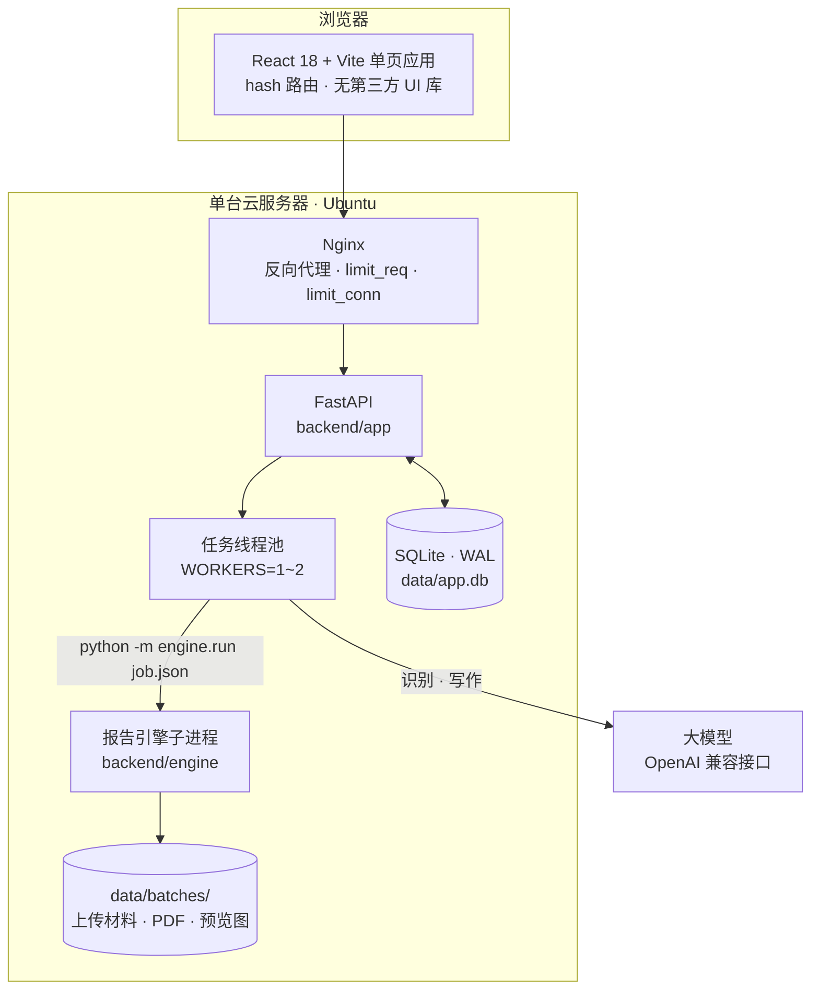
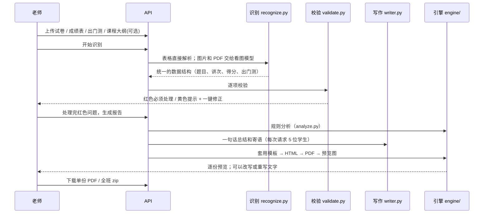

# 技术架构

## 1. 总体结构

**为什么这样设计**
- **只跑一个服务**：前端打包成静态文件，由后端统一提供，部署时只需要维护一个进程。
- **生成报告放到子进程里跑**：Chromium 转 PDF 又慢又占内存，放进子进程，出了问题也不会拖垮接口服务；进度写进 `progress.json`，前端每秒去读一次。
- **SQLite 就够用**：几十到几百位老师的规模，单机就能撑住，备份也只是复制一个文件。
- **服务重启时自动收尾**：卡在"识别中 / 生成中"的批次，会自动退回上一步并提示重新操作。

## 2. 一份报告是怎么生成的

## 3. 规则分析（`backend/engine/analyze.py`）

报告里的所有数字都由这里按固定规则计算，**不经过大模型**：

| 指标 | 规则 |
|---|---|
| 失分类型 | 这道题的全班得分率：≥ 80% 算**个人漏洞**，60%–80% 算**常规失分**，< 60% 算**全班难题** |
| 提分潜力 | 个人漏洞 + 常规失分 + 全班难题 × 0.5 |
| 成绩等级 | ≥ 90 为 A 优秀，≥ 80 为 B 良好，≥ 70 为 C 中等，≥ 60 为 D 合格，其余为 E 待提升 |
| 课堂与考试对照 | 把出门测（课堂）和考试得分率放在一起，判为**稳定掌握 / 已经补上 / 考试失分 / 需要关注** |
| 非 100 分制 | 先按满分折算，再套用同样的规则 |

大模型（`writer.py`）只拿到这些计算结果，然后写成一句话总结和寄语。字数有要求，而且**不允许改动任何数字**。

## 4. 识别（`backend/app/recognize.py` · `tables.py`）

| 材料 | 格式 | 处理方式 |
|---|---|---|
| 逐题成绩表 | Excel / CSV / Word 表格 | 直接解析：自动找到表头行、合并单元格补全、识别"满分"行和"总分"列 |
| 出门测记录表 | Excel / Word | 直接解析：第一行是讲次（合并单元格），第二行是知识点，✔ 记 1、× 记 0 |
| 试卷 | 题目表（题号、题型、分值、知识点、讲次） | 直接解析 |
| 试卷、拍照的表格 | 图片 / PDF | 交给看图模型，要求返回 JSON；识别没把握的格子标黄 |
| 续报课程大纲 | 任意格式 | 交给模型提取课程安排；不上传的话，报告里就没有"课程规划"这一节 |

题目顺序以成绩表的表头为准。表头里的班级名、考试名会自动识别出来，回填到报告信息里。

## 5. 校验（`backend/app/validate.py`）

| 等级 | 情况 | 一键修正 |
|---|---|---|
| 🔴 必须处理 | 名单里有重名 | — |
| 🔴 | 某道题缺少满分 / 没有归到讲次 | 在题目表里补上 |
| 🔴 | 得分超过满分 | 改为满分 |
| 🔴 | 各题合计和表中总分对不上 | 以系统合计为准 |
| 🔴 | 某一讲没有读到知识点 | 检查表头后重新识别 |
| 🟡 提示 | 空白格（按 0 分处理） | 确认是 0 分 |
| 🟡 | 识别没把握（成绩或出门测） | 确认 |
| 🟡 | 出门测表里缺少某位学生，或多出某位学生 | 知道了 |

**红色问题全部处理完，才能生成报告。**处理过的问题会保留处理记录，显示为"已处理"。

## 6. 数据模型（SQLite）

| 表 | 主要字段 |
|---|---|
| `users` | 账号、scrypt 密码哈希、称呼、`disabled`、个人额度 `quota`、默认信息 `prefs` |
| `sessions` | token（存在 HttpOnly Cookie 里）、过期时间 |
| `folders` | 名称、排序 |
| `batches` | 文件夹、状态（draft → recognizing → check → generating → review → done）、`meta`、识别数据 `data`、问题 `issues`、文字 `content`、结果 `result`、进度、自定义标题 `title`、排序 `sort` |
| `files` | 材料类型（paper / grade / exit / plan）、路径、大小 |
| `usage` | 每个账号每月已经用掉的次数 |
| `settings` | 网站设置，比如管理员在网页上改的邀请码 |

每次启动时，用 `ALTER TABLE` 自动给老数据库补上新字段，所以升级不丢数据。

## 7. 安全

| 层 | 措施 |
|---|---|
| 注册 | 邀请码；一次性图形验证码（Pillow 生成，5 分钟内有效） |
| 登录 | 同一个账号连续错 5 次锁 15 分钟；同一个 IP 的上限放宽到 4 倍；输错一次后才出现验证码 |
| 会话 | scrypt 加盐；HttpOnly + SameSite=Lax Cookie；上了 HTTPS 后打开 Secure；改密码后其他会话全部失效 |
| 权限 | 每个账号只能访问自己的文件夹和批次；管理员接口单独鉴权 |
| 限流 | 应用里按 IP 和接口限流；Nginx 再用 `limit_req` / `limit_conn` 限一层。真实 IP 取 `X-Forwarded-For` 的最后一段 |
| 上传 | 只允许白名单里的文件类型；单个文件大小有上限 |
| 服务器 | fail2ban 防 SSH 暴力破解；每天自动备份，保留 7 天 |
| 密钥 | 只放在服务器的 `.env` 里，前端代码里永远拿不到 |

## 8. 接口一览

| 分组 | 接口 |
|---|---|
| 账号 | `GET /api/auth/captcha` · `POST /api/auth/register` · `GET /api/auth/login-state` · `POST /api/auth/login` · `POST /api/auth/logout` · `GET/PATCH /api/auth/me` · `POST /api/auth/password` · `POST /api/auth/logout-others` · `POST /api/auth/delete` |
| 管理员 | `GET /api/admin/users` · `PATCH /api/admin/users/{uid}` · `POST /api/admin/users/{uid}/password` · `GET/PUT /api/admin/invite` |
| 文件夹 | `GET/POST /api/folders` · `PATCH/DELETE /api/folders/{fid}` · `POST /api/folders/order` |
| 批次 | `GET/POST /api/batches` · `POST /api/batches/order` · `GET/PATCH/DELETE /api/batches/{bid}` · `POST /api/batches/{bid}/copy` |
| 材料 | `POST /api/batches/{bid}/files` · `DELETE /api/batches/{bid}/files/{fid}` · `POST /api/batches/{bid}/recognize` |
| 核对 | `PUT /api/batches/{bid}/data` |
| 生成与审核 | `POST /api/batches/{bid}/generate` · `PUT /api/batches/{bid}/students/{name}` · `POST …/rewrite` · `POST …/confirm` · `POST /api/batches/{bid}/finish` |
| 下载 | `GET /api/batches/{bid}/preview/{key}/{page}` · `GET /api/batches/{bid}/pdf/{key}` · `GET /api/batches/{bid}/zip` · `GET /api/templates/{kind}` |
| 其他 | `GET /api/config` · `GET /api/health` |

启动后打开 `/api/docs`，可以看到自动生成的接口文档（Swagger）。
